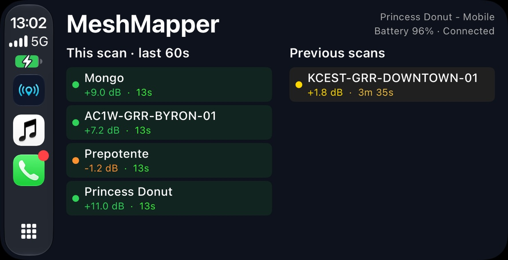

# CarPlay dashboard and status widget — draft review

This contribution adds a compact recent-repeater dashboard, a WidgetKit status widget using the existing Siri snapshot, and Flutter scene lifecycle integration. It preserves upstream's app identity and signing configuration.

## Release blocker

The custom UIKit dashboard sits beneath an empty CPMapTemplate and is not a map. Apple's approval message supplied to the contributor requires that layer to contain map content only. This prototype is not represented as App Store compliant. The owner must resolve the appropriate category/presentation with Apple, redesign the dashboard, or exclude it before release. A capability checkbox alone does not resolve this issue.

## Owner checklist

- Confirm acceptable CarPlay UI/category and obtain any required approval for the owner's account and App ID. The contributor's approval does not transfer.
- Verify the shared group `group.net.meshmapper.app.shared` is assigned to Runner, App Intents, and the Live Activity extension (which now also hosts the widget).
- Refresh provisioning profiles for the approved capabilities and extension App Group; update release/CI signing as needed. Keep the existing production IDs and private API-key workflow.
- Verify minimum Flutter/iOS support for the scene lifecycle APIs and the iOS-16-gated CarPlay delegate, including behavior on the iOS 15 deployment floor.
- Run full analysis/tests and a signed production archive. Validate app launch, background/foreground, lock/unlock, incoming calls, Bluetooth reconnect and CarPlay reconnect on devices. Disabling scene restoration fixed an observed crash but needs wider regression coverage.
- Verify battery/status updates, stale snapshots, Deferred/Skipped transitions, 60-second column migration, five-minute expiry, long names, signal colors and overflow counts on supported head units.
- Scrolling is a known limitation on the contributor's head unit and is out of scope; do not advertise scrollable history.
- Test WidgetKit separately: refresh timing and relevance are system-controlled, not guaranteed real-time or guaranteed Siri placement. Review reload frequency and extended-drive battery use.
- Add consented/sample-data screenshots and release notes for approved features. Keep this PR draft until release blockers are resolved; consider splitting the widget/lifecycle work from CarPlay.

## Integration notes

Integrated with upstream dev `65fc255` on November 20, 2026. The provider overlap is limited to two optional power snapshot fields; upstream logic and formatting are preserved. Personal signing, app-name, authentication/background identifiers, release notes and local dependency-lock changes are excluded. The personal phone-build checkout is unchanged.

Prior personal-build testing does not establish that this upstream integration passes production signing or App Store review. The integrated branch still needs a signed iOS build and device testing.

Historical validation before the November upstream merge: all 263 tests in `test/services/app_intents` and `test/services/status` passed. Dependencies were resolved from the local cache; the local SDK resolved four test-library versions differently, but that lockfile churn was not retained in the contribution. Repeat tests with the upstream CI toolchain before merge.

The contributor successfully installed a signed personal build based on upstream `4d690c5` on November 18 and reported successful use on November 20. This is manual evidence for the dashboard, not a signed archive or full regression pass for this contribution branch. The two newer upstream commits change donation links. Plist/project syntax and diff whitespace checks passed after integration.

## Device screenshot

Current post-merge validation on November 20: **266 tests passed** with `flutter test --no-pub test/services/app_intents test/services/status`.

User-supplied dashboard screenshot from the tested personal build (real companion/repeater names, shared with permission). The phone map screenshot is omitted because it includes location information.

